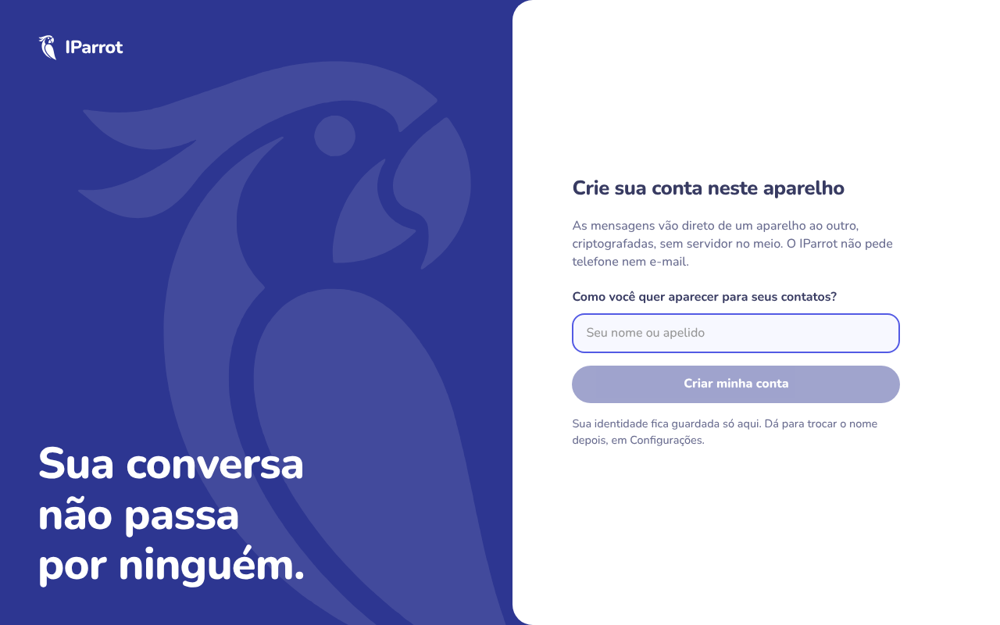
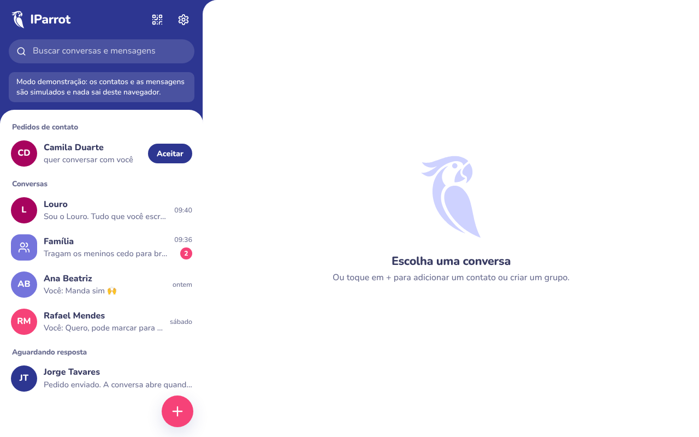
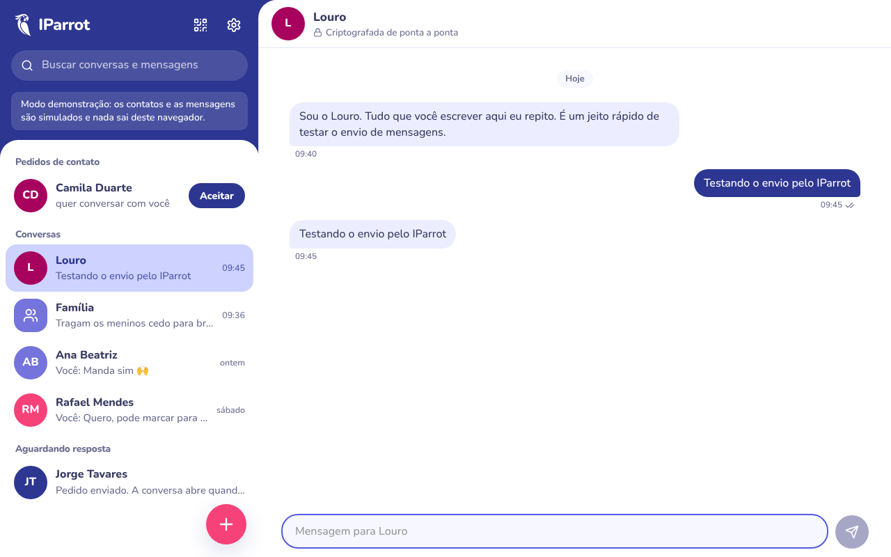
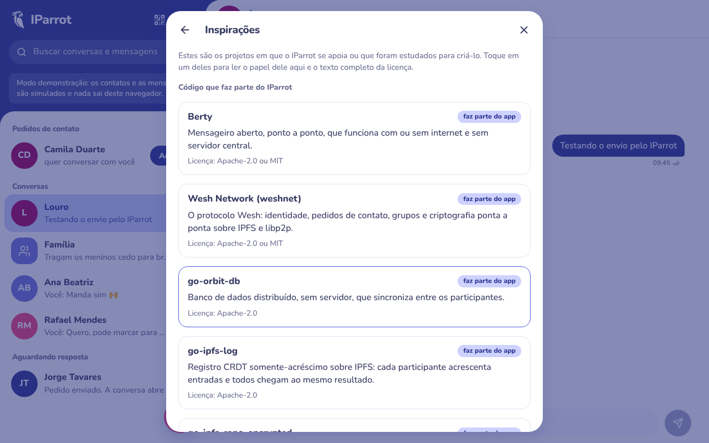
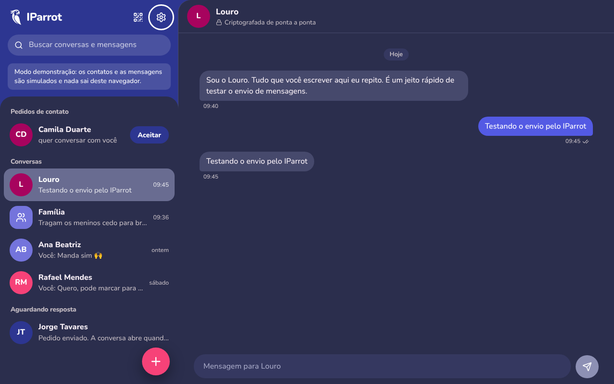
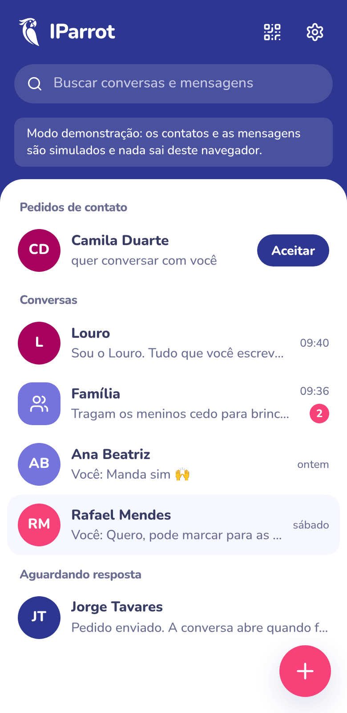
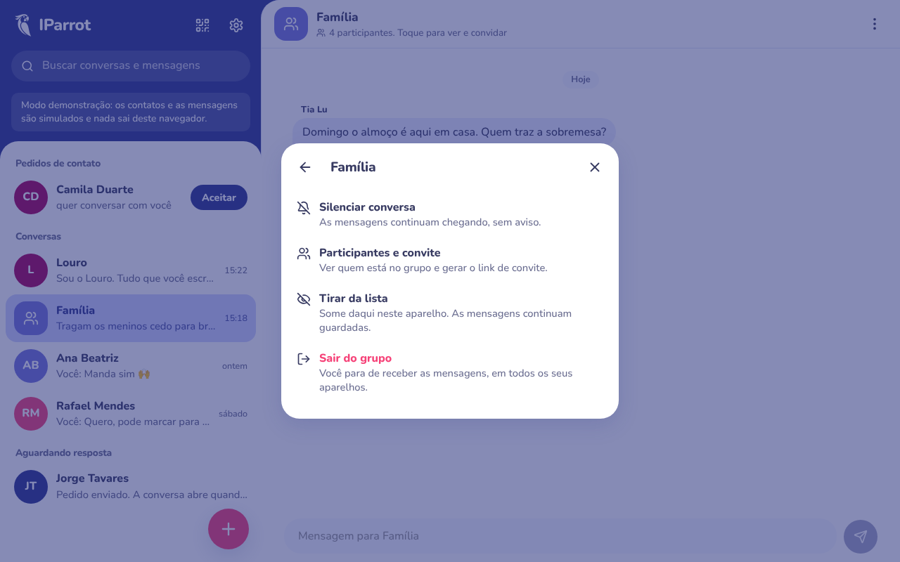
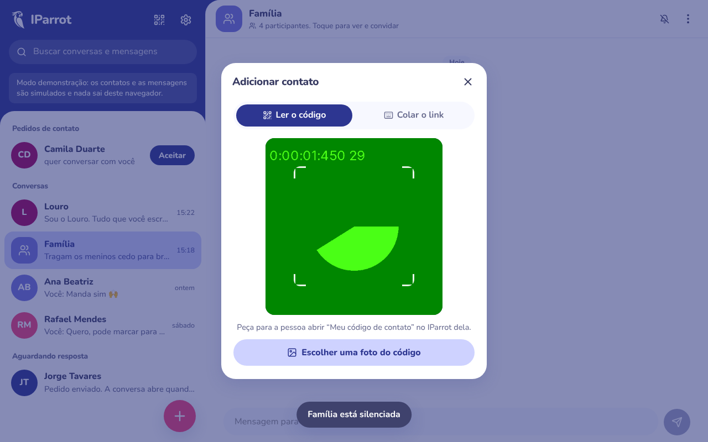
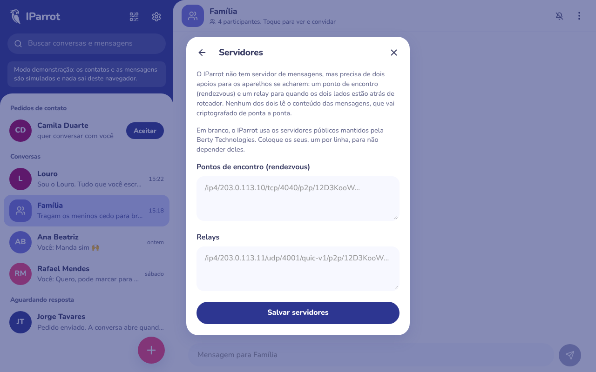
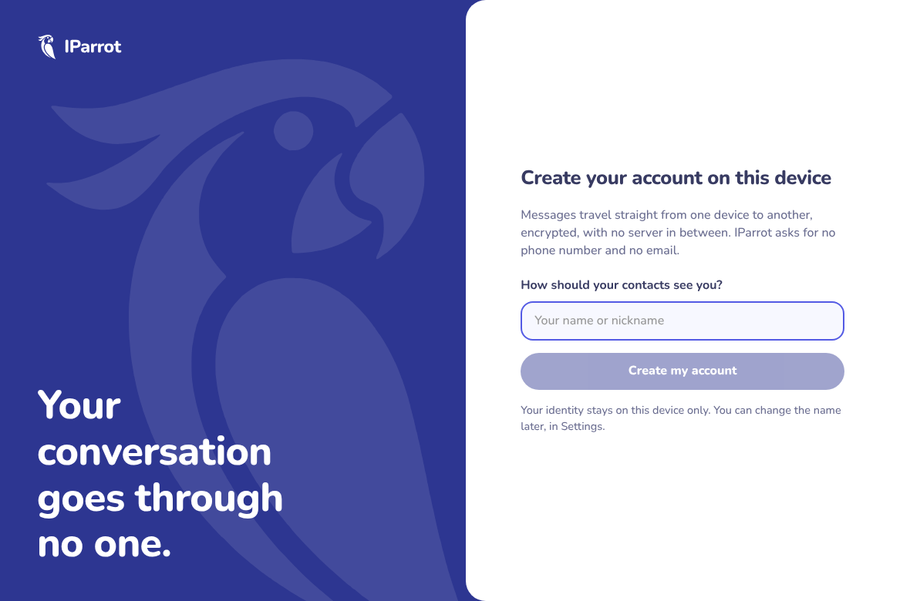

# IParrot

Mensageiro ponto a ponto, criptografado de ponta a ponta e sem servidor central, para **Android, iOS, Windows e Linux**.

O IParrot é construído sobre a mesma tecnologia do [Berty](https://github.com/berty/berty): o protocolo
[Wesh](https://github.com/berty/weshnet) (IPFS + libp2p), bancos distribuídos [go-orbit-db](https://github.com/berty/go-orbit-db) /
[go-ipfs-log](https://github.com/berty/go-ipfs-log) e armazenamento criptografado
([go-ipfs-repo-encrypted](https://github.com/berty/go-ipfs-repo-encrypted)). Por usar o mesmo protocolo e a mesma camada de
mensagens, um contato do IParrot consegue conversar com um contato do Berty.

## Estado atual (v0.1.0)

| Parte | Situação |
| --- | --- |
| Interface (`ui/`) | Compila, passa na checagem de tipos e foi conferida no navegador (desktop, celular, tema claro e escuro) em modo demonstração. |
| Núcleo Go (`core/`, `main.go`, `cmd/`) | **Compila**, nas cinco frentes da CI. Escrito contra o código-fonte do Berty v2.472.0 e do weshnet, com cada chamada conferida uma a uma. Testes das partes que só usam a biblioteca padrão passam (`core/node/*_test.go`, `core/api/pure_test.go`). |
| Projetos nativos (`mobile/android`, `mobile/ios`) | **Compilam**: APK de depuração e build de simulador iOS. Gerados pelo Capacitor 7 e personalizados: ícones, plugin do núcleo, serviço em primeiro plano e notificações no Android, Keychain no iOS, permissões de câmera e rede. |
| CI (`.github/workflows/build.yml`) | Verde nos cinco jobs; publica `.exe`, binário Linux e APK como artefatos. |
| **Rodando de verdade** | **Ainda não.** Compilar não é funcionar: nenhuma mensagem foi trocada entre dois aparelhos até agora. Esse é o próximo teste, e o que de fato valida o projeto. |

O que já existe na interface: criar conta (só um nome, sem telefone nem e-mail), código/QR de contato, **ler o QR pela
câmera**, pedidos de contato, conversas individuais, grupos com convite por link/QR, busca, confirmação de entrega,
**silenciar, tirar da lista, sair do grupo e bloquear**, **backup da conta**, **servidores próprios**, tela de rede,
tema claro/escuro, **português, inglês e espanhol**, e **Configurações > Sobre > Inspirações** com todas as licenças.

## Telas

| | |
| --- | --- |
|  |  |
|  |  |
|  |  |
|  |  |
|  |  |

## Como é por dentro

```
┌────────────────────────── interface única (ui/) ──────────────────────────┐
│  React + TypeScript + Vite — a mesma build em todas as plataformas        │
└───────────────▲───────────────────────────────────────────────▲───────────┘
                │ HTTP em 127.0.0.1 + token   (JSON e eventos SSE)
┌───────────────┴───────────────────────────────────────────────┴───────────┐
│  núcleo Go (core/)                                                         │
│   api      servidor local: contatos, grupos, mensagens, eventos            │
│   node     Berty Messenger ─▶ Wesh (weshnet) ─▶ OrbitDB / ipfs-log ─▶ IPFS │
│            tudo em disco criptografado com SQLCipher                       │
└───────────────▲──────────────────────▲──────────────────────▲─────────────┘
        Wails (main.go)        gomobile (core/iparrotcore)   iparrotd (cmd/)
        Windows .exe, Linux    Android .aar, iOS .xcframework  sem janela
                               dentro do Capacitor (mobile/)
```

Detalhes em [docs/ARQUITETURA.md](docs/ARQUITETURA.md). O que foi estudado em cada repositório está em
[docs/ESTUDO.md](docs/ESTUDO.md).

## Começar

Ver a interface agora, sem núcleo (modo demonstração):

```bash
cd ui && npm ci && npm run dev      # http://localhost:5173
```

Compilar de verdade (precisa de Go 1.26.5+, Node 20+ e compilador C):

```bash
make deps              # go mod tidy — gera o go.sum (faça commit dele)
make run               # núcleo + interface no navegador
make tools desktop-linux
make android           # JDK 21 + Android SDK/NDK
make ios               # macOS + Xcode + CocoaPods
```

No Windows, o `.exe` é gerado pela CI ou com os comandos de [docs/BUILD.md](docs/BUILD.md).

Se for compilar num servidor que já roda outras coisas, use a bancada em container — ela não instala nada no host:
[build/docker/README.md](build/docker/README.md).

## Antes de usar com pessoas de verdade

1. **Trocar uma mensagem entre dois aparelhos.** Os binários saem da CI, mas ninguém nunca conversou por eles. Instale
   em dois aparelhos seus, troque o código de contato e veja a mensagem chegar antes de qualquer outra coisa.
2. **Servidores de apoio.** Sem configuração, o nó usa o rendezvous e o relay públicos da Berty Technologies
   (endereços embutidos no weshnet). Eles não leem mensagens, mas são infraestrutura de terceiros sem garantia.
   Para produção, suba o seu com [`server/rdvp/`](server/rdvp/README.md) — um container só, que faz encontro e relay —
   e aponte em **Configurações > Rede > Usar meus próprios servidores**, ou pelas variáveis `IPARROT_RDVP` e
   `IPARROT_RELAYS`.
3. **Segundo plano no celular.** No Android o nó continua no ar por um serviço em primeiro plano, com aviso fixo. No
   iOS o sistema não permite equivalente: lá a entrega acontece quando o app volta a ficar aberto. Em ambos, falta push
   e um servidor de replicação para quem está offline.
4. **Backup.** A tela de backup já existe; **restaurar ainda não**. Guarde o `.tar` em lugar seguro: ele não é
   criptografado e quem o abrir vira você no IParrot.
5. **Auditoria.** O próprio Berty avisa que o protocolo ainda está em desenvolvimento e não deve ser usado para dados sensíveis.

Lista completa em [docs/ROADMAP.md](docs/ROADMAP.md).

## Licença

Apache-2.0 ou MIT, à sua escolha (ver [COPYRIGHT](COPYRIGHT)). Avisos de terceiros em [NOTICE.md](NOTICE.md).
O IParrot é um projeto independente, não afiliado à Berty Technologies.
